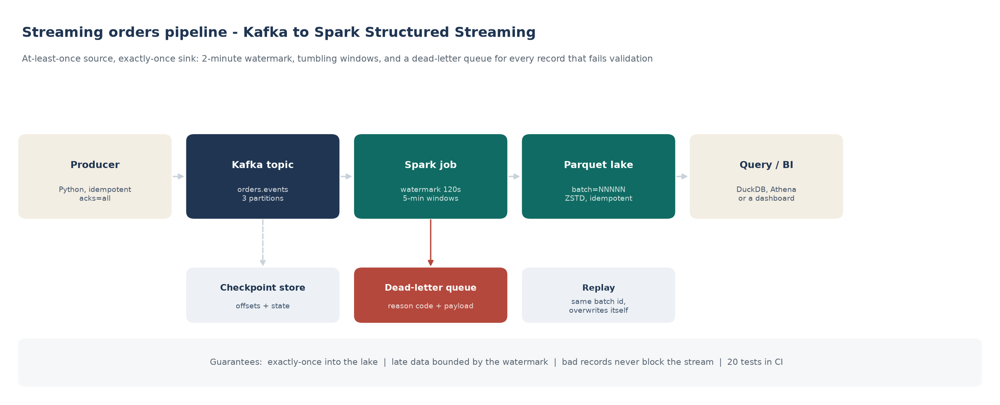
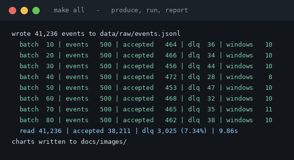
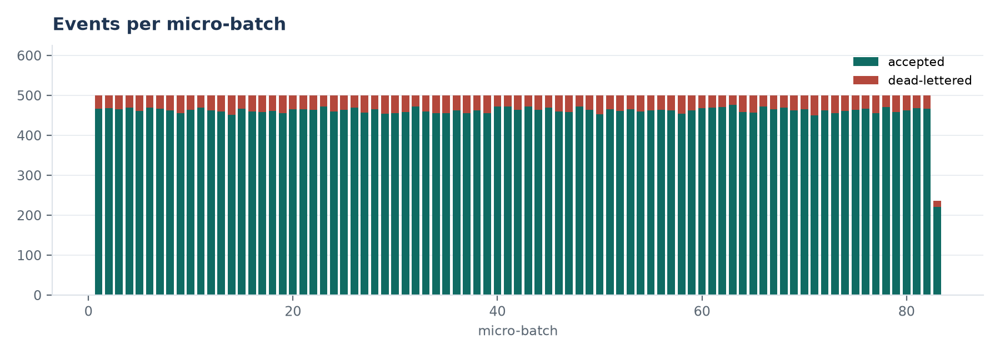
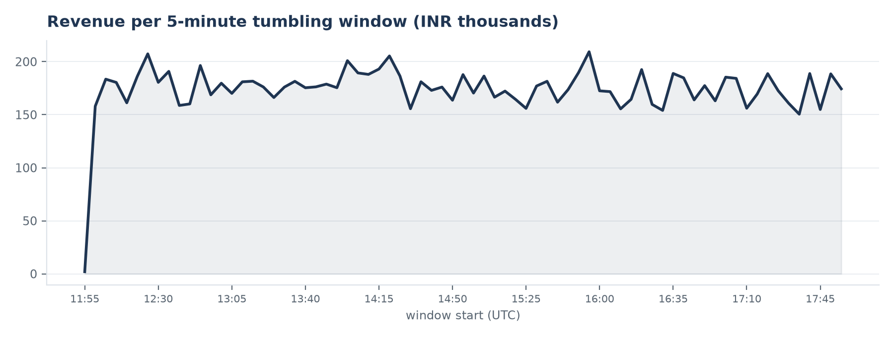
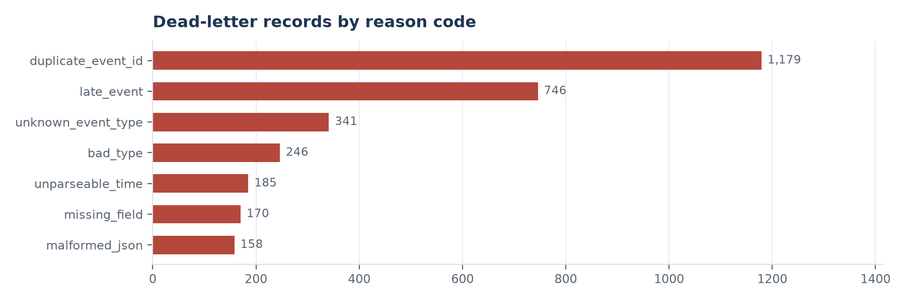

# Streaming Orders Pipeline


Real-time order events from Kafka, aggregated into 5-minute tumbling windows by
Spark Structured Streaming and written to a parquet lake exactly once - with a
2-minute watermark for out-of-order data and a dead-letter queue that explains
every record it rejects.

The streaming semantics are implemented twice on purpose: as a real PySpark job
for Kafka, and as a micro-batch engine in plain Python that runs **without Docker
in about ten seconds**. The local engine is what the tests exercise and what the
charts below were drawn from.



| Signal | Value |
|---|---|
| Events processed | 41,236 in 83 micro-batches |
| Accepted / dead-lettered | 38,211 / 3,025 (7.34%) |
| Throughput | ~3,700 events/sec on one core, no Spark |
| Window rows written | 781 (5-minute windows x country) |
| Tests | 20 passing |
| Guarantee | exactly-once into the lake; replayed batches overwrite themselves |



---

## The problem this solves

An e-commerce checkout publishes events to Kafka: order placed, order paid,
order shipped, order cancelled. Three things go wrong with this stream, and a
naive consumer fails on all of them.

1. **At-least-once delivery.** Roughly 3% of events arrive twice. Counting them
   inflates revenue.
2. **Out-of-order arrival.** Mobile clients buffer and flush late, so events
   arrive after the window they belong to has closed.
3. **Poison records.** A truncated JSON payload, a string where an amount should
   be, an unknown event type - and a single bad record kills the whole consumer
   if you do not isolate it.

This pipeline answers each one: dedupe on `event_id`, bound lateness with a
watermark, and route anything invalid to a dead-letter log with a reason code
instead of dropping it silently or crashing.

## How it works

| Stage | What happens | Where |
|---|---|---|
| Produce | Synthetic stream with realistic defects, produced with `acks=all` and idempotence | `src/streaming/producer.py` |
| Validate | Every record checked against the contract; failures get a reason code | `src/streaming/events.py` |
| Watermark | Highest event time seen minus 120 s; anything older is late | `src/streaming/windows.py` |
| Aggregate | 5-minute tumbling windows by country: orders, paid, cancelled, revenue | `src/streaming/windows.py` |
| Sink | One parquet part per micro-batch, named by batch id, so a replay overwrites | `src/streaming/sink.py` |
| Dead letter | JSONL with reason, explanation, batch id and payload snippet | `src/streaming/sink.py` |

## Quickstart - no Docker, no Kafka

```bash
git clone https://github.com/Yashu24-coder/streaming-orders-pipeline.git
cd streaming-orders-pipeline
pip install -r requirements.txt
make all          # produce -> run -> report
make test
```

Or without make:

```bash
export PYTHONPATH=src
python -m streaming.cli produce
python -m streaming.cli run
python -m streaming.cli report
pytest -q
```

That processes 41,236 events in 83 micro-batches and writes the charts in
`docs/images/`. Everything lands under `data/`, which is gitignored.

## Running the real stack

```bash
docker compose up -d          # Kafka (KRaft) + Kafka UI on :8080
make produce-kafka            # produce to localhost:9092
spark-submit \
  --packages org.apache.spark:spark-sql-kafka-0-10_2.12:3.5.1 \
  spark/structured_streaming_job.py
```

The Spark job reads the same topic, applies the same watermark and the same
validation rules, and writes the same parquet shape. `docker-compose.yml` is
configured with three partitions so the windowed aggregation is actually
shuffling.

## What the stream looks like



83 micro-batches of 500 events, about 7% dead-lettered per batch. The last batch
is short because the stream ends mid-batch - worth noticing, because a naive
"batch must be full" assertion would fail on the tail.



Revenue per 5-minute window, summed across countries. Only `order_paid` adds
revenue; `order_placed` and `order_cancelled` are counted in the same row so the
funnel is visible without a second join.



Every rejection is explainable. Duplicates dominate (1,179), which is the
at-least-once contract doing its thing, followed by genuinely late events (746)
and real data defects.

## Dead-letter reason codes

| Code | Meaning | What you do about it |
|---|---|---|
| `duplicate_event_id` | the same event was delivered twice | nothing - dedupe worked |
| `late_event` | event time older than the watermark | alert if the rate climbs; check producer clocks |
| `unknown_event_type` | a new event type the contract does not know | add it to `VALID_TYPES` deliberately |
| `bad_type` | amount is a string, not an integer | fix the producer serialiser |
| `unparseable_time` | `event_time` is not ISO-8601 | fix upstream formatting |
| `missing_field` | a required field is absent | reject at the source |
| `malformed_json` | truncated payload | producer bug or a partial write |

## Testing

20 tests, no Kafka and no Spark needed:

| File | What it pins down |
|---|---|
| `test_events.py` | every defect maps to the right reason code; negative amounts allowed only on cancellation |
| `test_windows.py` | window flooring, same-window grouping, per-country buckets, watermark boundary behaviour |
| `test_pipeline.py` | end-to-end run, idempotent re-run, duplicate dropping, dead-letter explanations |

`test_pipeline.py::test_rerun_is_idempotent` is the one that matters: it runs the
pipeline twice over the same input and asserts the part-file count does not grow.
That is the exactly-once claim, tested rather than asserted.

## Design decisions

- **Local engine, not a mock.** `local_runner.py` implements the same contract as
  the Spark job - validate, watermark, window, sink - so the tests exercise real
  behaviour rather than a stub. The Spark file is the production executor.
- **Deterministic part names.** `part-batch-00042.parquet` means a replayed batch
  overwrites itself. Spark gets the same property from checkpointed offsets plus
  `mode("overwrite")` on a batch-id path.
- **Watermark of 120 seconds.** Chosen against the actual lateness in the
  synthetic stream: enough to absorb mobile buffering, small enough that closed
  windows can be released.
- **Duplicates go to the DLQ rather than being silently filtered.** They are a
  signal about the producer, and hiding them hides a real operational fact. The
  reason code makes the difference between "expected" and "a producer is
  retrying too aggressively" visible.
- **Windows carry the funnel.** Placing, paying and cancelling in one row costs
  nothing and saves every downstream query a join.

## What this project does not do

- **The Spark job is not executed in CI.** There is no Kafka broker in GitHub
  Actions; the workflow runs the local engine and the tests. The PySpark file is
  written and reviewed but exercised only when you run the Docker stack.
- **The data is synthetic.** `producer.py` generates the stream, including the
  defects, from a fixed seed. The defects are deliberate and the reason-code
  counts in the charts come from a real run of the local engine.
- **No schema registry.** A production deployment would use Confluent Schema
  Registry or Glue Schema Registry so an incompatible change is rejected at the
  producer rather than at the consumer.
- **No alerting.** The DLQ rate is a metric waiting for an alarm; wiring it to
  CloudWatch or Prometheus is the obvious next step.
- **State is in memory.** The dedupe set is a Python `set`, which is fine for a
  demo and wrong for production - that is what RocksDB state stores and the
  watermark are for in Spark.

## Author

Built by **Kavali Yashwanth Royal** - data engineer, Bangalore.
[GitHub](https://github.com/Yashu24-coder) ·
[LinkedIn](https://www.linkedin.com/in/yashwanth-royal-kavali-226378259) ·
yashwanthroyal9133@gmail.com

If you are reviewing this, read `src/streaming/windows.py` and
`tests/test_pipeline.py` first - the watermark and the idempotency test are the
whole project.
