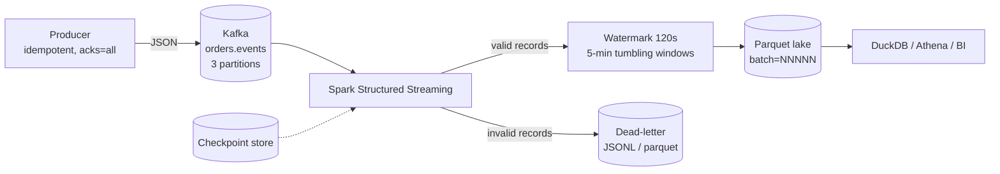

# Architecture

## Shape

## Contracts

**Event contract** (`src/streaming/events.py`): seven fields, five event types,
`amount_cents` an integer. Negative amounts are legal only for
`order_cancelled`, because a cancellation is a reversal.

**Delivery contract**: the source is at-least-once, so the consumer must be
idempotent. Two mechanisms enforce that:

1. dedupe on a 64-bit fingerprint of `event_id` within the run;
2. a deterministic output path per micro-batch, so replaying a batch replaces its
   file instead of appending.

**Lateness contract**: a watermark of `max_event_time - 120s`. An event at or
after the watermark is accepted into its window; anything older is
`late_event`. This is what lets the engine release window state without losing
the ordering guarantee.

## Why two implementations

The Spark job is what runs in production; the local engine is what runs in the
tests and in `make all`. They share the validation rules, the window function
and the sink shape. Keeping both means:

- a reviewer without Docker can see the pipeline work in ten seconds;
- the logic has unit tests, which Spark jobs rarely do;
- any divergence between them is a review comment, not a silent bug.

The risk is drift. The mitigation is that both files carry the same reason codes
and the same window definition, and the CI job asserts the local engine's
dead-letter rate stays in a sane band.

## Failure handling

| Failure | Detection | Response |
|---|---|---|
| Poison record | validation returns a reason code | routed to the DLQ, stream continues |
| Duplicate delivery | fingerprint already seen | DLQ with `duplicate_event_id`, revenue unaffected |
| Late event | `event_time < watermark` | DLQ with `late_event`; raise the watermark if the rate is chronic |
| Job restart | checkpoint offsets | resumes from the last committed batch; the in-flight batch replays and overwrites |
| Producer clock skew | a burst of `late_event` | alert; the watermark is not the fix, the clock is |
| Kafka partition rebalance | consumer group protocol | no data loss because offsets are committed after the sink write |

## Sizing notes

- `maxOffsetsPerTrigger = 20000` in the Spark job caps a single micro-batch, so a
  backlog after downtime is drained over several batches instead of one giant
  shuffle.
- `spark.sql.shuffle.partitions = 8` is deliberate for a local three-partition
  topic; at real volume this becomes a multiple of the partition count.
- Window output is one row per window per country, so cardinality is bounded by
  time x countries, not by event volume. That is why the lake stays small.
